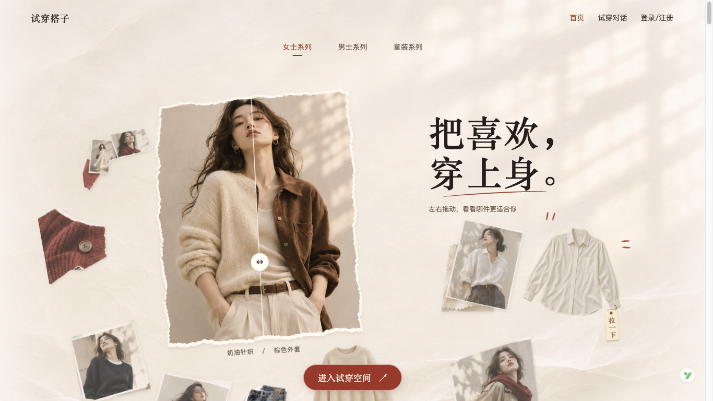
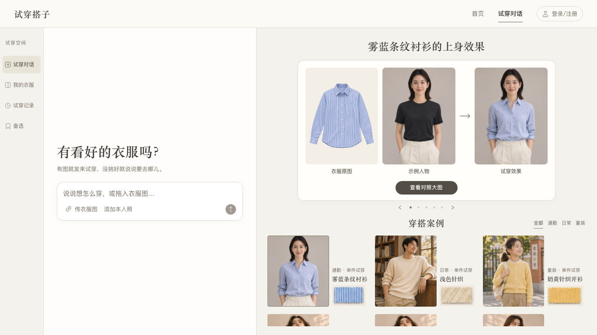
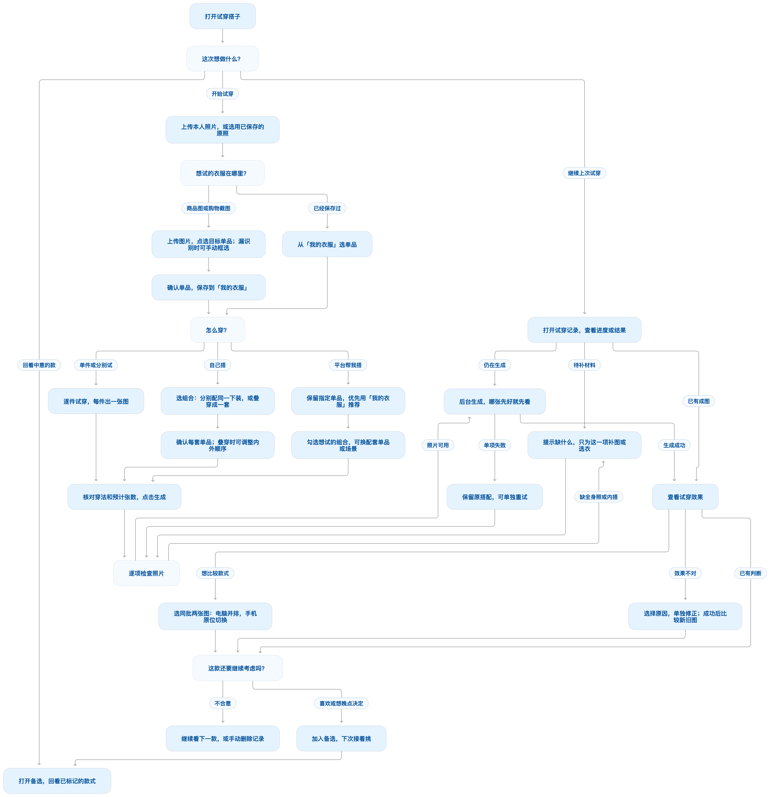

# 试穿搭子 · B 版

**[打开在线展示页](https://ethan101-liu.github.io/tryon-buddy/)** · **[下载单文件 Demo](https://github.com/Ethan101-Liu/tryon-buddy/raw/refs/heads/main/docs/index.html)**

打开展示页先看到首页，点击「试穿对话」进入工作台。可以浏览女士、男士和童装系列，拖动对比、切换穿搭案例和放大图片。单文件 Demo 已内嵌图片、样式和脚本，下载后用浏览器打开即可。在线展示与离线 Demo 的 AI 搜衣、上传审核和生成需要完整项目后端及使用者自己的服务配置。

### 首页



### 试穿工作台



## 项目做什么

试穿搭子是一个支持电脑与手机的中文 AI 试衣框架。上传本人照和衣服图片，或描述想穿的单品、场合，再查看试穿效果、比较版本、继续替换单品。前端采用原生 HTML、CSS 和 JavaScript，Python 后端负责搜衣、图片检查、生成任务与结果返回。

默认实现接入阿里云百炼和图片审核服务。使用者配置自己的密钥与额度，也可以按 [模型接入说明](docs/model-integration.md) 替换理解、识图、生成或审核服务。

## 从打开页面到选定穿搭

1. **进入试穿对话**。首页展示系列案例，点击顶部「试穿对话」或底部入口进入工作台。
2. **准备本人照**。点击「添加本人照」上传人物照片，也可使用当前浏览器已保存的照片。完整后端支持读取 HEIC 并转换图片。换下装时需要能够看清相应部位。
3. **提供衣物或说明需求**。用「传衣服图」上传商品图，或从「我的衣服」选择单品。还没有挑好时，输入「换个卫衣」或「周一面试，想穿裤子」，后端理解需求、搜索候选并核对衣物图。
4. **确认搭配并生成**。根据对话补充缺少的照片、单品或场合信息。输入图片检查通过后创建生成任务，多件搭配按顺序编辑，尽量保留人物、画幅和未替换的衣物。
5. **查看进度与处理失败**。工作台显示搜索、生成和审核状态。结果审核暂时失败时保留生成结果，支持继续审核，避免为同一结果重复生图。运行中任务保存在后端内存，重启后不会继续。
6. **查看效果并比较版本**。放大成图，比较前后搭配。可以保留上衣换下装，或选回旧版本继续搭配。
7. **保存与回看**。成图可在「试穿记录」回看，喜欢或待定的款式加入「备选」。衣物、账号演示数据及历史记录以当前浏览器为单位保存。

### 用户主流程图

下图为项目的完整产品流程设计，包含从素材准备、单件或成套试穿到对比和备选的路径。它也包含批量任务、手动框选和同批两图比较等设计目标，具体可用能力以本仓库 B 版界面及下方范围说明为准。



[打开原尺寸流程图](docs/user-flow.png)

## 安装与运行

需要 Python 3.12。以下命令适用于 macOS 或 Linux。

```bash
git clone https://github.com/Ethan101-Liu/tryon-buddy.git
cd tryon-buddy
python3.12 -m venv .venv
source .venv/bin/activate
python -m pip install -r requirements.txt
mkdir -p .runtime
cp .env.example .runtime/cloud.env
```

Windows 可用 `py -3.12 -m venv .venv` 创建环境，用 `.venv\Scripts\Activate.ps1` 激活，再通过资源管理器创建 `.runtime` 文件夹，将 `.env.example` 复制为其中的 `cloud.env`。

编辑 `.runtime/cloud.env`，填写自己的配置。

| 配置 | 用途 |
| --- | --- |
| `DASHSCOPE_API_KEY` | 百炼 API Key，用于理解需求、识别衣物和生成 |
| `BAILIAN_WORKSPACE_ID` | 与 API Key 对应的北京地域业务空间 ID |
| `ALIBABA_CLOUD_ACCESS_KEY_ID` | 图片审核服务所需的 RAM AccessKey ID |
| `ALIBABA_CLOUD_ACCESS_KEY_SECRET` | 对应的 AccessKey Secret |
| `QWEN_VISION_MODEL` | 可选，理解与识图模型，默认 `qwen3-vl-plus` |
| `QWEN_IMAGE_MODEL` | 可选，支持当前双图编辑接口的模型，默认 `qwen-image-3.0` |

默认模型名称与接口来自本项目实现。请在自己的账号中确认模型开通情况、接口协议和额度。密钥只供后端读取，环境变量优先于配置文件。配置修改后重启服务。

```bash
python serve_demo.py
```

打开 [本机首页](http://127.0.0.1:18793/collections/) 或 [本机工作台](http://127.0.0.1:18793/#styling)。保持终端运行，按 Ctrl+C 停止服务。完整项目的静态文件由 `dist/` 提供，`docs/index.html` 是方便分享的独立展示版本。

## 模型与后端流程

浏览器将本人照、衣物和文字需求提交给 Python 后端。后端完成图片格式检查与审核，调用理解模型生成搭配动作，用图片搜索取得衣物候选并核验，创建生成任务，依次编辑选中的单品，审核结果后返回浏览器保存。

模型调用集中在 `aliyun_services.py`。使用现有百炼接口时填写自己的凭据即可；更换同协议模型时配置模型名称；使用其他厂商或本地模型时，按 [接入文档中的函数契约](docs/model-integration.md) 实现对应调用。

| 文件或目录 | 职责 |
| --- | --- |
| `dist/` | 响应式页面、对话、衣柜、记录、备选与示例素材 |
| `serve_demo.py` | 静态服务、HTTP API、搜衣、任务队列、审核恢复 |
| `aliyun_services.py` | 理解、识图、图片生成、云端审核适配 |
| `image_policy.py` | 图片与文字检查、审核缓存 |
| `提示词/` | 上传规则与试穿约束 |
| `tests/` | 审核恢复、并发及配置回归测试 |
| `docs/index.html` | 可独立分享的完整展示页 |
| `.env.example` | 空白凭据及可选模型配置 |

## 当前范围

- 已实现首页、试穿对话、服装上传、搜衣、连续替换单品、案例查看、记录与备选。
- 登录使用本机演示账号，记录保存在浏览器中，跨设备账号同步和服务端用户隔离需要部署者继续实现。
- 任务队列使用后端内存，输入审核缓存存入 `.runtime/`，进程重启会结束未完成的任务。
- 原始流程图覆盖更完整的产品目标，批量任务、手动框选及部分比较流程仍需进一步开发与验收。
- 默认服务监听 `127.0.0.1`，适合本机使用。面向公网提供真实生成时，需要补齐身份验证、任务归属和额度管理。
- 在线演示托管在 GitHub Pages。真实试穿运行 Python 后端，云端调用费用由配置密钥的使用者承担。本人照、衣物和成图会按流程提交给所接服务。

## 验证

```bash
python -m unittest discover -s tests -v
```

回归测试使用替代服务验证队列和恢复行为。真实成图质量、延迟及费用需用自己的模型配置另行验证。

## 开源协议

本项目采用 [MIT License](LICENSE)，允许使用、修改、分发和商业使用，分发时保留版权和许可声明。外部模型服务与运行时搜索取得的商品图片适用各自的服务条款和权利要求。
