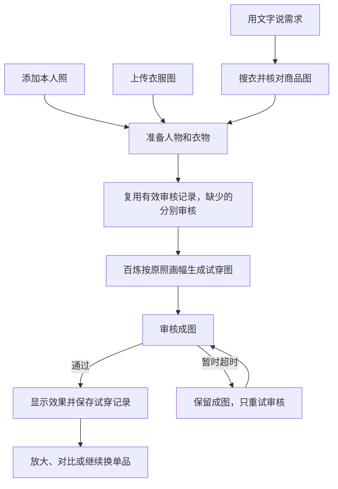

# 试穿搭子

试穿搭子是一个支持电脑和手机的中文 AI 试衣工作台。上传本人照，再发一张衣服图，或者说一句「给我换个卫衣」，就能看到衣服穿在自己身上的效果。想比较两条裤子时，可以保留选中的上衣，只换下装，再打开前后两版对照。


## 一次试穿怎么走

1. 打开「试穿对话」，点「添加本人照」，从相册选择照片。手机 HEIC 照片会转换为 JPEG。
2. 有商品图就点「传衣服图」。手边没有图，可以输入「给我换个卫衣」或「周一面试，想穿裤子」，工作台会搜索衣物并核对商品实图。单件试穿只搜索对应部位。
3. 素材就绪后，后台核对图片审核记录，调用百炼生成效果图，再审核成图。生成时沿用原照的宽高比，要求保留原来的取景和未替换的衣物。
4. 在对话里放大成图，或从「试穿记录」重新打开。喜欢的搭配可以加入「备选」，也可以选回旧版本继续试。记录保存在当前浏览器，手机和电脑分别保存。



## 在自己的电脑运行

使用 Python 3.12，在仓库根目录执行以下命令。下面以 macOS 或 Linux 为例。

```bash
python3.12 -m venv .venv
source .venv/bin/activate
python -m pip install -r requirements.txt
mkdir -p .runtime
cp .env.example .runtime/cloud.env
```

打开 `.runtime/cloud.env`，填入自己的四项配置。每个部署使用自己的阿里云额度，密钥由 Python 后端读取。

| 配置 | 从哪里取得 |
| --- | --- |
| `DASHSCOPE_API_KEY` | [百炼北京地域的 API Key](https://help.aliyun.com/zh/model-studio/get-api-key/) |
| `BAILIAN_WORKSPACE_ID` | 与这把 Key 对应的[北京业务空间 ID](https://bailian.console.aliyun.com/cn-beijing/settings/workspace) |
| `ALIBABA_CLOUD_ACCESS_KEY_ID` | 开通图片审核增强版后，在 [RAM 用户管理](https://ram.console.aliyun.com/users) 创建获准调用图片审核的用户，取得 AccessKey ID |
| `ALIBABA_CLOUD_ACCESS_KEY_SECRET` | 同一用户的 AccessKey Secret，授权步骤见[图片审核接入指南](https://help.aliyun.com/zh/document_detail/467828.html) |

保存配置并启动工作台。

```bash
python serve_demo.py
```

打开 [本机试穿工作台](http://127.0.0.1:18793/#styling)。使用时保持后端运行，修改密钥后重启。图片审核、识图和试穿会把相应素材发送到阿里云。右侧穿搭案例使用项目自带的示例图。

## 代码与服务

| 位置 | 负责什么 |
| --- | --- |
| `dist/` | 电脑与手机页面、相册上传、对话、试穿记录与示例素材 |
| `serve_demo.py` | 提供页面和 API，处理搜衣、任务状态、审核重试和结果返回 |
| `aliyun_services.py` | 用千问理解需求和衣物，调用百炼 `qwen-image-3.0` 试穿，对接阿里云图片审核 |
| `image_policy.py`、`提示词/` | 检查上传素材，管理审核记录和试穿约束 |

GitHub 链接用于查看或复制项目。实际试穿需要启动后端并配置自己的服务凭据。
